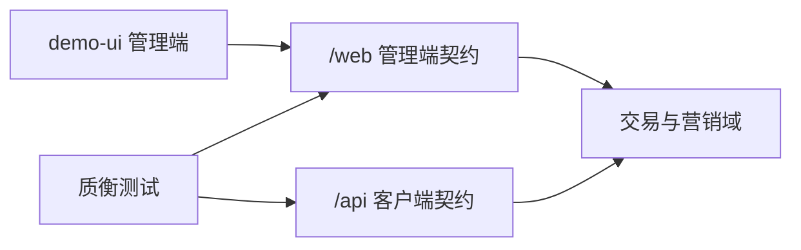

端客户端」。# 商城业务扩充路线图

本文档是 `qualitest-demo-mall` 的**业务与接口**长期清单。  
**主路径**：先增强已有交易域的可测深度，再按需补新域；始终保持可被质衡测到（双端 JWT、`@api.group`、场景种子、AI 提示）。  
C 端界面（小程序 / App / H5 等）**不是**本仓主交付；若有人要做，另见文末「可选：C 端客户端」。

按分期落地；表中「状态」取值：未开始 / 进行中 / 已完成。

## 1. 定位与现状

### 1.1 定位

| 项 | 说明 |
|---|---|
| 仓库角色 | 质衡联调靶场（默认端口 `8801`，库 `qualitest-demo-mall`） |
| 管理端 | `/web/**` 等 + `demo-ui`（若依风格 CRUD / 场景控制台） |
| 客户端契约 | `/api/**` + 账号 JWT（`POST /api/account/auth/login` → `accountToken`） |
| 认证约定 | 管理端 Token 与客户端 Token **不可混用**；客户端从 Token 取 `accountId` |

### 1.2 已有业务域

- 账号：注册 / 登录 / 登出 / 资料 / 改密
- 收货地址、余额流水与模拟充值
- 优惠券领取、我的券、下单可用券
- 分类、商品 SPU/SKU、购物车
- 订单：preview / create / pay / cancel / confirmReceive
- 退款：preview / apply / my / cancel
- 进阶：RustFS 文件上传（`/api/file`）

场景种子见 `sql/seed/scenarios/manifest.json`（S01–S08 / F01–F12）；自然语言提示见 [ai-test-flow-prompts.md](./ai-test-flow-prompts.md)。

### 1.3 扩充方向（两手）

1. **增强已有域**（优先）：同一路径上加校验、状态、筛选、幂等与失败场景——测面立刻变厚，不必先开新表  
2. **补新域**（按需）：搜索、多渠道模拟支付、物流轨迹、评价等（见 §4）

## 2. 落地检查单

增强已有接口或新开域时，合入前建议核对下列项（可按实际删减）。本检查单是合入规范，不单独跟踪进度。

1. 表结构变更（若有；init SQL / 变更脚本）
2. `domain` 与业务内核（写操作不在两端 Controller 各写一份）
3. 管理端 / 客户端入出参与 API（含 `@api.group`）
4. 管理端薄页或动作按钮（可选）
5. seed 场景（成功 / 失败）与 `manifest.json`
6. [ai-test-flow-prompts.md](./ai-test-flow-prompts.md) 提示条目
7. Swagger 可测；必要时 README 一句说明

分层约定见仓库 Cursor 规则 `qualitest-demo-mall-backend`。

## 3. 已有能力增强（优先）

下列都挂在**现有表与 `/api`、`/web` 故事**上；每项至少补 1 条成功或失败场景 + AI 提示。

### 3.1 账号 / 地址 / 余额

| 点 | 建议 | 测试价值 | 状态 |
|---|---|---|---|
| 登录失败细分 | 密码错误 / 停用以外：空参、错误次数提示（可配置阈值） | 负向断言、文案稳定 | 未开始 |
| 资料与头像 | `profile` 可改昵称；头像走 `/api/file` + `bizType=avatar` | 文件 + 账号联动 | 未开始 |
| 改密后旧 Token | 改密使旧客户端 Token 失效（或文档明确仍有效） | 鉴权边界 | 未开始 |
| 地址上限 / 默认互斥 | 最多 N 条；设默认时取消其它默认；删默认地址规则 | 状态机小闭环 | 未开始 |
| 地址校验 | 手机号格式、省市区必填（可先字符串规则） | 参数校验场景 | 未开始 |
| 余额流水筛选 | 已有分页；补类型/时间范围过滤的稳定约定与场景 | 列表查询断言 | 未开始 |
| 充值边界 | `amount≤0`、超大金额拒绝 | 边界值 | 未开始 |

### 3.2 商品 / 分类 / SKU

| 点 | 建议 | 测试价值 | 状态 |
|---|---|---|---|
| 列表查询增强 | `keyword`、分类、价格/销量排序（仍属商品域增强） | 组合查询 | 未开始 |
| 详情字段 | 主图/图集（file key）、简介；无图时的空列表约定 | 详情断言 | 未开始 |
| 库存汇总 | SPU `stock_total` 与 SKU `stock` 写路径一致；下架后不可购 | 数据一致性 | 未开始 |
| 销量回写 | 支付成功累加 `sales_count`；退款是否回滚写清规则 | 副作用可测 | 未开始 |
| 管理端批量上下架 | 已有单条 `changeShelfStatus`；可加批量 | 管理端批量操作 | 未开始 |
| 分类停用 | 停用分类下商品列表不可见或不可加购 | 可见性规则 | 未开始 |

### 3.3 购物车

| 点 | 建议 | 测试价值 | 状态 |
|---|---|---|---|
| 同 SKU 合并 | 再次加购累加数量，不新增行 | 幂等/合并 | 未开始 |
| 加购上限 | 单行数量上限、超库存拒绝（与下单库存规则对齐） | 与 F04 呼应 | 未开始 |
| 失效行 | 下架/停用 SKU 在「我的购物车」标记不可结算；结算时剔除或整单失败（二选一写死） | 脏数据路径 | 未开始 |
| 勾选结算 | 行级 `selected`；preview/create 只吃勾选行 | 部分结算 | 未开始 |
| 数量接口 | 已有改数量；补 `quantity=0` 视为删除或拒绝 | 边界 | 未开始 |

### 3.4 优惠券

| 点 | 建议 | 测试价值 | 状态 |
|---|---|---|---|
| 领取库存/名额 | 券总量或每人限领（已有重复领 F12；可加发完） | 库存类负向 | 未开始 |
| 适用范围 | 全场 / 指定分类或商品（薄实现即可） | 用券失败新场景 | 未开始 |
| 占券释放 | 关单/超时后券回到可用（S02 已有关单释放；补超时路径） | 与订单联动 | 未开始 |
| 我的券筛选 | 未用 / 已用 / 过期分状态查询 | 列表过滤 | 未开始 |
| 多券 | 明确「一单一券」并加「同时传两张」拒绝场景 | 规则文档化 | 未开始 |

### 3.5 订单 / 支付（字段已有，行为可加深）

订单表已有 `pay_type`（1 微信 2 支付宝 3 余额），当前主路径基本是余额。

| 点 | 建议 | 测试价值 | 状态 |
|---|---|---|---|
| 订单列表筛选 | 按 `order_status` / 时间；客户端 `my` 已分页则补状态 Tab 约定 | 列表+断言 | 未开始 |
| 待付款改地址/留言 | 仅待付款可改收货信息或备注 | 状态门禁 | 未开始 |
| 取消原因 | 必填枚举或长度限制；取消后库存/券释放断言加强 | 副作用 | 未开始 |
| 支付方式 | 余额路径保持；微信/支付宝走「模拟支付单+回调」（见 §4，属支付增强） | 幂等/回调 | 未开始 |
| 重复支付 / 已取消再付 | S03/F 类已有；补「已取消订单 pay」拒绝 | 状态机 | 未开始 |
| 运费规则 | 固定运费已有；可加包邮门槛或多件运费规则（写清公式） | 金额公式断言 | 未开始 |
| 管理端发货 | `deliver` 可要求运单号（为物流域打底，也可先只存字段） | 管理端必填 | 未开始 |
| 确认收货门禁 | 非待收货不可确认；完成后不可再确认 | 幂等 | 未开始 |

### 3.6 退款

| 点 | 建议 | 测试价值 | 状态 |
|---|---|---|---|
| 退款类型 | 表有「仅退款 / 退货退款」；把退货退款走通（待退货→确认收货→退款） | 更长状态链 | 未开始 |
| 退款原因枚举 | 固定原因码 + 自定义说明 | 入参校验 | 未开始 |
| 凭证图 | 申请时可传 file key 列表 | 文件+退款 | 未开始 |
| 部分退后再退 | 提示集已有；补金额/数量上限算式与场景 ID | 金额精确断言 | 未开始 |
| 管理端拒绝后再申请 | 拒绝后是否允许再申，写死并测 | 状态回转 | 未开始 |

### 3.7 文件 / 场景基建

| 点 | 建议 | 测试价值 | 状态 |
|---|---|---|---|
| bizType 白名单 | `avatar` / `refund` / `product` 等；非法类型拒绝 | 上传负向 | 未开始 |
| 删除权限 | 只能删本人上传；越权 403 | 与 F09 同类 | 未开始 |
| 场景包 | 为上面增强点各加 S/F 场景，避免只改代码无种子 | 可复现 | 未开始 |

### 3.8 建议落地顺序（已有域）

1. 购物车失效行 + 同 SKU 合并 + 加购上限（纯客户端故事，场景好写）  
2. 商品列表查询增强 + 销量/库存一致性  
3. 订单列表状态筛选 + 取消/确认收货门禁  
4. 券适用范围或领完 + 我的券状态筛选  
5. 退款类型/拒绝后再申等状态链  
6. 再开 §4 新域（模拟支付回调、物流轨迹、评价）

## 4. 新域补齐（按需）

在已有域增强告一段落或并行需要时再开；仍走 §2 检查单。

### 4.1 模拟支付 / 履约 / 评价

| 优先级 | 模块 | 建议薄实现 | 状态 |
|---|---|---|---|
| P0 | 模拟支付渠道 | 支付单 → 成功/失败回调（幂等、重复通知）；与订单 `pay_type` 1/2 对齐 | 未开始 |
| P1 | 物流轨迹 | `mall_order_shipment` + 轨迹点；客户端时间线；管理端录运单 | 未开始 |
| P1 | 商品评价 | 确认收货后可评；SPU 聚合分 | 未开始 |

### 4.2 稳定性与运营（选修）

| 模块 | 建议 | 状态 |
|---|---|---|
| 库存并发 | 乐观锁 / 预占；失败场景「超卖拦截」（加深现有库存故事） | 未开始 |
| 超时关单 | Quartz 关闭待付款 + 释券释库存 | 未开始 |
| 会员积分 / 签到 | 简单积分抵扣 | 未开始 |
| 运营工作台 | 管理端待发货 / 待审退款 | 未开始 |
| 简单统计 | GMV、退款率等接口 | 未开始 |

## 5. 边界与非目标

### 5.1 必须遵守

- 保持若依 + JWT 单线；**不**把 Session / HMAC 等异框架 merge 进本仓（姊妹靶另仓）
- 新接口带 `@api.group`，并尽量补场景与 AI 提示
- 仓名与靶场职责不变；对外说明以 README 为准
- 管理端继续服务运营与场景控制台；**不要**把 `demo-ui` 改成 C 端商城

### 5.2 明确不做或长期后置

- 真实微信 / 支付宝商户号与清算（模拟回调即可）
- 复杂促销引擎、推荐算法、直播、IM 客服
- 不为「看起来更重」而引入 Elasticsearch、分库分表、微服务拆分
- 不重做整套若依管理端视觉（仅按需增强订单等工作台）
- **不以任何 C 端框架（含 uni-app）作为本仓主路径或合入门槛**

## 6. 可选：C 端客户端

> 可选、附属。有需要时再开独立目录；**不**阻塞 §3 / §4，也**不**要求贡献者实现。

若要做可视化演示，约定如下即可：

| 项 | 建议 |
|---|---|
| 工程位置 | 独立目录（例如 `demo-mall-uni/`），**勿**塞进 `demo-ui` |
| 技术 | 自选（uni-app / 纯 H5 / 其他）；若选 uni-app，可同时编微信小程序与 App |
| 对接 | 只调现有 `/api/**` + 客户端 Bearer |
| 造数 | 客户端不负责；场景仍走 `POST /web/test/scenario/load/{id}` 或 SQL |
| 主路径演示账号 | `13800000001` / `Test@123456`（与靶场种子一致） |

页面能力对照（有客户端时再跟；与 §3 / §4 无依赖顺序）：

| 页面 / 能力 | 主要客户端接口 | 状态 |
|---|---|---|
| 登录 / 注册 | `/api/account/auth/login`、`/register` | 未开始 |
| 首页：分类 + 商品列表 | `/api/mall/mallCategory/enabled`、`/api/mall/mallProduct/list` | 未开始 |
| 商品详情 + SKU | `/api/mall/mallProduct/{id}/detail` | 未开始 |
| 购物车 CRUD | `/api/mall/mallCart/my*` | 未开始 |
| 结算：地址 / 券 / preview→create | `accountAddress`、`accountCoupon`、`mallOrder/preview|create` | 未开始 |
| 收银台：余额支付 / 充值引导 | `mallOrder/.../pay`、`accountBalanceRecord/recharge` | 未开始 |
| 订单列表 / 详情 / 取消 / 确认收货 | `mallOrder/my*` | 未开始 |
| 退款预览 / 申请 / 我的退款 | `mallOrderRefund/*` | 未开始 |
| 我的：资料 / 地址簿 / 券 / 余额流水 | `auth/profile`、`accountAddress`、`accountCoupon`、`accountBalanceRecord` | 未开始 |

## 7. 相关文档

- 快速启动与认证：[../README.md](../README.md)
- Compose 部署：[deploy.md](./deploy.md)
- AI 测试流提示：[ai-test-flow-prompts.md](./ai-test-flow-prompts.md)
- 场景元数据：`../sql/seed/scenarios/manifest.json`
- 后端双契约分层：仓库 Cursor 规则 `qualitest-demo-mall-backend`
